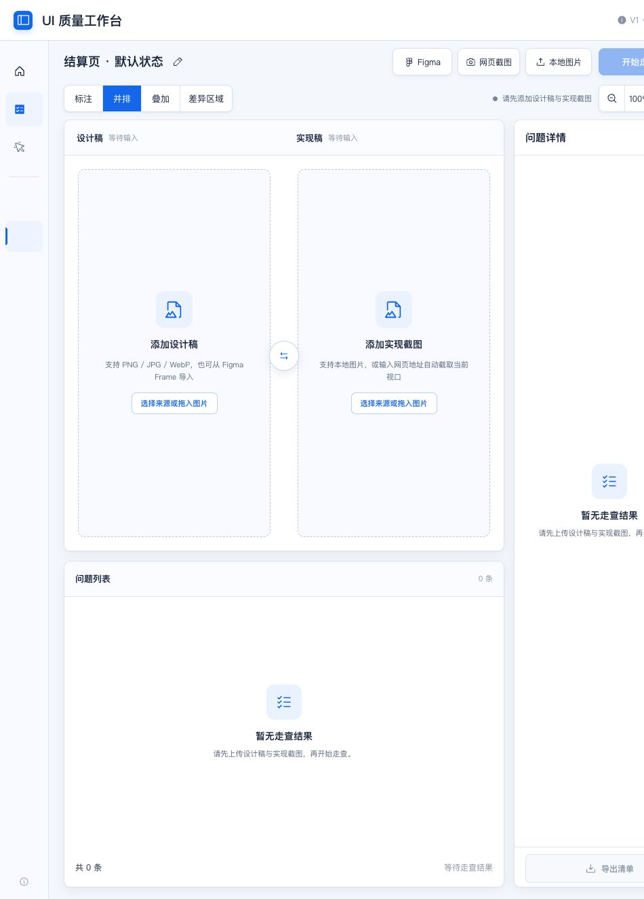

# 设计工具箱

一个以 Codex Skill 形式运行的本地设计工具平台，集中提供 **UI 走查**、**工具分享** 和 **视频下载**：对照设计稿检查实现效果，分享好用的 AI 工具与 Skill，也可以直接解析视频链接、选择清晰度并下载到磁盘。

平台原名为“UI 质量工作台”。为兼容已有安装，仓库地址、Skill 标识和启动方式仍保留 `ui-quality-workbench`。

> 当前已实现 **UI 走查**、**工具分享** 和 **视频下载**。交互体验审查、无障碍审查、DOM/计算样式检查、多人协作等能力仍在规划中。



## 已实现能力

### 视频下载

- 左侧“视频下载”直接完成链接解析、清晰度选择、下载、进度显示和取消任务，文件由本地服务写入设定的保存目录。
- 下载期间可以切换模块；页面重新打开会恢复本次服务中的任务。关闭服务会停止正在运行的任务，已下载文件保留。
- 复用本机的 [yt-dlp](https://github.com/yt-dlp/yt-dlp)、Deno、FFmpeg、FFprobe。可使用 yt-dlp GUI 安装的引擎，正常下载流程无需打开独立桌面应用。本地桥接支持 macOS 和 Windows。
- 首次启动自动创建 `~/Downloads/设计工具箱` 作为默认保存位置，已有的自定义路径保持不变。点击“更改保存位置”可使用工具箱内的文件夹选择器；设置仅保存在本机，之后启动仍然有效。更改只影响新任务，已完成任务的“打开文件夹”会定位它实际保存的视频。
- 首次启动自动检测并补齐 yt-dlp、Deno、FFmpeg、FFprobe；页面显示安装进度，失败时可点击“重试安装依赖”。已有可用程序继续复用，不会在每次启动时重新下载或升级。
- 自动安装支持 macOS（Intel / Apple 芯片）和 Windows x64：无需预装 Homebrew，无需管理员权限或修改系统 PATH。依赖放在本机工具箱配置目录下的 `bin`；下载后检查 SHA-256 和程序运行结果，FFmpeg 还会验证 H.264 编码器。
- 本机设置：macOS 为 `~/Library/Application Support/DesignToolbox/video-downloader.json`；Windows 为 `%LOCALAPPDATA%/DesignToolbox/video-downloader.json`。其中保存 `downloadsDirectory`、`tools` 四个程序路径和可选的 `appPath`。已有旧配置保持兼容，个人设置不随项目发布。
- 当前支持单个公开视频，最多同时运行 3 个解析/下载任务，保留本次服务最近 30 个任务。直播、播放列表和登录凭据配置暂不支持；平台可用性仍取决于下载引擎、网络和视频访问条件。
- 音视频自动合并为 MP4，并检查实际编码；VP9、AV1 等不兼容常用本地播放器的流会转为 H.264 / AAC-LC，已兼容的流不会重复有损编码。转换前的文件保存在同目录的 `.originals` 中。
- 磁盘未连接或不可写时会阻止开始下载；确认输出文件包含有效视频、符合兼容编码且转换前后时长一致后才显示已保存。

### 工具分享

- 通过左侧“工具分享”浏览收藏卡片，点击卡片查看能力介绍、使用场景、操作流程与适用边界。
- 首批收录 **Cowart AI 创作画布**（工具插件，含 3 个 Skill）和 **移动端低保真原型工作流**（`ui-wireframe-workflow`）。
- 卡片与详情均提供“一键安装”：打开安装提示词，点击复制，再粘贴到支持相关安装能力的 AI 工具（例如 Codex）中发送。
- Cowart 提示词指向作者公开仓库；移动端原型提示词内嵌完整的 4 个 Skill 文件，无需访问分享者电脑。
- 复制失败时可全选后手动复制；卡片“已收集”表示已加入分享清单，不代表访客已安装。

### UI 走查

- 对设计稿与实现截图进行像素和轮廓分析，生成待人工复核的差异候选，并支持整理、确认和导出审阅清单。
- 从本地选择或拖拽导入 PNG、JPEG、WebP 设计稿和实现截图；两个输入区域各自只接受一张图片。
- 通过包含 `node-id` 的 Figma `design` / `file` 链接和个人访问令牌（PAT），导入指定 Frame/Node 的 PNG 渲染图。
- 使用临时、隔离的 Chrome/Chromium/Edge 配置，为 HTTP(S) 页面截取指定尺寸的当前视口。
- 对比前以较宽图片的宽度为目标：较宽图片保持 1×，只将较窄图片等比例放大到相同宽度；支持顶部、底部和元素对齐，不会非等比拉伸或静默裁剪。
- 元素对齐支持在两张图中粗略圈选同一个按钮、文字或菜单，自动吸附视觉边界后按识别锚点平移，并只分析两图重叠区域。
- 并排模式使用一个共享滚动画布，设计稿和实现稿会同步上下、左右滚动；两侧输入均可独立替换或移除。
- 在生成局部问题前执行输入可比性检查：低可比性输入停止分析，中等可比性输入保留人工复核警告。
- 在浏览器 Worker 中运行启发式像素差异、边缘分析和空间分组，生成差异候选。
- 在对比视图、问题列表和详情面板中人工确认、驳回或忽略候选，并分别设置严重度、优先级和备注。
- 默认导出已确认的问题，支持 Markdown、JSON 和带标注验收板 PNG。

## UI 走查使用方式

1. 导入一张设计稿和一张实现截图，尽量保证路由、状态、内容、语言、视口和滚动位置一致。
2. 检查宽度归一化预览并选择合适的对齐方式。没有可靠的顶部或底部参照时，可粗略圈选两张图中的同一个稳定元素进行对齐。
3. 点击“开始走查”。输入可比性过低时不会生成容易误导的问题列表。
4. 把分析结果视为候选，而不是已确认缺陷，逐条排除字体加载、抗锯齿、动态内容、动画时机和过期设计稿等干扰。
5. 完成人工确认、严重度与优先级判断后导出清单。

## 安装和启动（macOS / Windows）

下载或克隆 GitHub 文件本身不会执行安装。**首次运行启动器会自动安装缺少的视频依赖**，需要联网并等待安装完成。Python 3.9+ 是启动器前提；让 Codex 安装时，也应先检查或配置 Python。

可以直接把下面这段发给 Codex：

```text
请从 https://github.com/BrainLiuYH/ui-quality-workbench 安装最新版设计工具箱。
按仓库 AGENTS.md 和 workbench/skill-package/SKILL.md 完成安装。
检查 Python 3.9+，复制完整 Skill 包；运行 start.py --install-only 安装视频依赖并确认成功，
然后运行 start.py 启动完整本地服务，打开 ready 事件返回的网址。
确认 yt-dlp、Deno、FFmpeg、FFprobe 都已可用，保留已有保存目录。
```

使用预编译包，无需 Node.js 或前端构建。仓库根目录和安装后的 Skill 目录都可启动：

- **Windows**：双击 `start-windows.cmd`，或在终端运行 `py -3 start.py`。
- **macOS**：在终端运行 `python3 start.py`。
- 使用浏览器工具打开时可加 `--no-open`；只安装依赖用 `--install-only`；离线/只想检查用 `--no-install`；`--check` 只检查应用包和服务接口，不安装软件。

启动器只监听 `127.0.0.1`。等待页面依赖全部就绪后，粘贴**一条**视频链接解析。保持启动器进程运行；只运行 `pnpm dev`、静态预览或双击 HTML 不会启动下载服务。安装为 Skill 时，必须复制整个 `workbench/skill-package`，包括启动器、脚本、预编译资源及说明文件。

依赖来源：yt-dlp 与 Deno 使用各自 GitHub 官方 Releases；Windows FFmpeg / FFprobe 使用 [yt-dlp/FFmpeg-Builds](https://github.com/yt-dlp/FFmpeg-Builds)；macOS 使用提供原生两种架构构建的 [ffmpeg-static](https://github.com/eugeneware/ffmpeg-static)。二进制在用户本机下载，不打包进本仓库。校验失败、网络不可达或不支持的架构会明确报错，可以重试；不会绕过系统安全限制。

手动替代：已有 Homebrew 可运行 `brew install yt-dlp deno ffmpeg`；Windows 可使用 WinGet 安装 `yt-dlp.yt-dlp`、`DenoLand.Deno`、`Gyan.FFmpeg`。安装后点击“重新检测”。

## 从仓库直接运行

已打包的 Skill 不需要安装前端依赖。需要 Python 3.9+ 和支持现代浏览器 API 的浏览器（Windows 将 `python3` 替换为 `py -3`）：

```bash
python3 start.py --check
python3 start.py
```

启动器会输出一行包含 `event: "ready"`、动态回环地址和进程信息的 JSON。请使用它返回的完整地址。

可选能力还有额外要求：Figma 导入需要有效 PAT 和访问 Figma 的网络；网页截图需要本机安装受支持的 Chrome、Chromium 或 Edge。

## 本地开发

前端源码位于 `workbench/`，使用 React 和 Vite。使用仓库内的 pnpm 锁文件安装依赖：

```bash
cd workbench
pnpm install --frozen-lockfile
pnpm run dev
```

常用校验命令：

```bash
pnpm run build
pnpm run test
```

`pnpm run build` 会生成浏览器静态文件和 Sites Worker 交付物，并把最新浏览器构建同步到 `workbench/skill-package/assets/workbench/`。不要假设开发服务器的代码会自动进入已打包 Skill。

## 目录结构

```text
.
├── README.md
├── docs/                         # 产品、数据模型与规划文档
│   └── assets/                   # README 预览资源
└── workbench/
    ├── src/                      # React 工作台与对比引擎源码
    ├── tests/                    # Node 与 Python 测试
    ├── scripts/                  # 构建与本地启动脚本
    ├── worker/                   # Sites Worker
    └── skill-package/            # 可由 Codex 安装的独立 Skill
        ├── SKILL.md
        ├── scripts/
        ├── references/
        └── assets/workbench/     # 已构建的工作台
```

## 隐私与安全边界

- 本地图片的解码、归一化和差异分析留在当前浏览器会话中；项目本身不提供云端账户、存储或远程任务服务。
- 本地桥接服务只监听回环地址，并对来源和写入请求使用每次启动生成的令牌。这些措施降低暴露面，但不构成正式安全审计或端到端隐私保证。
- Figma 导入会把 PAT 发送给 Figma API，并下载指定节点的 PNG。界面中临时输入的 PAT 不由启动器持久化；通过 `FIGMA_ACCESS_TOKEN` 提供的令牌会在启动器进程生命周期内存在。
- 网页截图会让隔离浏览器请求目标 URL。它不会继承日常浏览器的 Cookie、登录状态、扩展、打开的标签页或本地存储。
- 不要把 PAT、启动令牌、Cookie 或其他凭据写入截图、日志、导出清单或仓库。

## 重要限制

- 分析器没有 OCR、产品语义或设计意图，只能依据栅格像素与轮廓做启发式判断；所有输出都必须人工复核。
- 不检查 DOM、可访问性树、源码、计算样式、设计 Token、键盘操作或多步骤交互流程。
- Figma 能力只导入链接指向的单个节点图像，不浏览文件、不提取组件/变量/原型交互，也不是 OAuth 登录。
- 网页能力只截取指定的当前视口，不滚动拼接全页、不操作页面，也不继承认证状态。
- 宽度归一化和元素对齐不能让不同路由、响应式断点、页面状态或完全不同的内容结构变得可比。
- 归一化后的对比画布上限为 3200 万像素；超限时需要提供尺寸更接近的输入，或在导入前对两张图采用一致范围的裁剪。

更完整的运行边界见 [V0 能力说明](workbench/skill-package/references/v0-boundaries.md)，候选复核与优先级规则见 [审查决策模型](workbench/skill-package/references/audit-model.md)。

